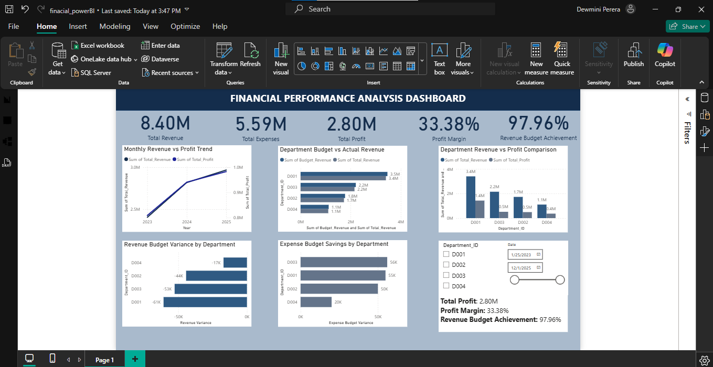

# End-to-End Data Analytics Project

## Project Overview
This project demonstrates an end-to-end data analytics workflow using Microsoft Excel, SQL, Python, and Power BI to analyze business data and present meaningful insights.

## Tools & Technologies
- **Microsoft Excel:** Data cleaning, formulas, PivotTables, and analysis
- **SQL (SQLite):** Data querying, filtering, and aggregation
- **Python:** Data analysis and exploratory data analysis using pandas
- **Power BI:** KPI visualization, DAX measures, and interactive dashboards

## Project Files
- Excel workbook: Data preparation and analysis
- SQL file: SQL queries used for analysis
- Python file: Data analysis code
- Power BI file: Interactive dashboard
- CSV file: Dataset, if included

## Key Learning Outcomes
- Practiced data preparation and analysis across multiple tools
- Developed an interactive business performance dashboard
- Strengthened data visualization and analytical problem-solving skills

## Author
Aspiring Data Analyst | Excel | SQL | Python | Power BI

## Dashboard Preview

